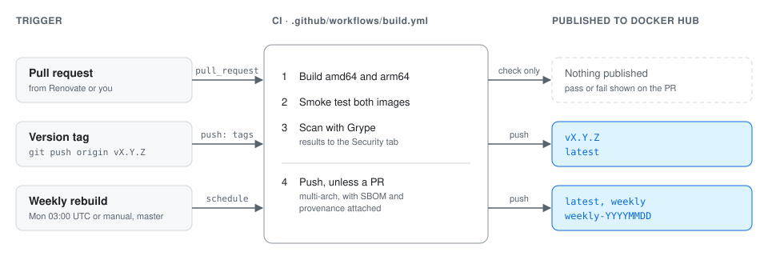

# Repo Maintenance

## How Images Are Built and Published
<picture>
  <source media="(prefers-color-scheme: dark)" srcset="docs/images/release-pipeline-dark.svg">
  
</picture>

All three paths run the same workflow, [.github/workflows/build.yml](.github/workflows/build.yml). An image is only pushed after both architectures pass [scripts/smoke-test.sh](scripts/smoke-test.sh). Branch protection on `master` requires the `build` check to pass before any PR can be merged, admins included.

- **Renovate** opens PRs on Monday mornings when the base images, yq, nats or GitHub Actions have new versions. Review and merge if CI is green.
- **Weekly rebuild** (Mondays 03:00 UTC) rebuilds master to pick up Ubuntu security patches. No action needed.
- **Releases** happen when you push a `vX.Y.Z` tag.

## Where Versions Live
| What                   | Where                                                            | Updated by               |
| ---------------------- | ---------------------------------------------------------------- | ------------------------ |
| Ubuntu base image      | `FROM ubuntu:26.04@sha256:...` in [Dockerfile](Dockerfile)       | Renovate (digest)        |
| Go used to build tools | `FROM golang:...` in [Dockerfile](Dockerfile)                    | Renovate                 |
| yq, nats               | `ARG YQ_VERSION`, `ARG NATS_VERSION` with `# renovate:` comments | Renovate                 |
| mc                     | `ARG MC_VERSION`                                                 | Fixed; upstream archived |
| apt packages           | Not pinned                                                       | Weekly rebuild           |
| GitHub Actions         | [.github/workflows/build.yml](.github/workflows/build.yml)       | Renovate (digest)        |

To track a new Go tool with Renovate, add an `ARG` with a comment above it in the same format:
```dockerfile
# renovate: datasource=github-releases depName=OWNER/REPO
ARG TOOL_VERSION=v1.2.3
```

## Making a Change
```bash
git switch -c my-change

# edit the Dockerfile, then build and test locally
docker build -t kubernetes-admin-toolkit:testing .
./scripts/smoke-test.sh kubernetes-admin-toolkit:testing

# poke around (optional)
docker run -it --rm kubernetes-admin-toolkit:testing

# open a PR - CI builds and tests amd64 and arm64
git push -u origin my-change
gh pr create --fill

# merge once CI passes
gh pr merge --squash --delete-branch
```

When adding a tool, also add it to the `for cmd in ...` list in [scripts/smoke-test.sh](scripts/smoke-test.sh) and the table in [README.md](README.md#whats-inside).

Local builds are amd64 only unless QEMU is set up. To test arm64 locally:
```bash
docker run --privileged --rm tonistiigi/binfmt --install arm64
docker buildx build --platform linux/arm64 --load -t kubernetes-admin-toolkit:arm64 .
./scripts/smoke-test.sh kubernetes-admin-toolkit:arm64 linux/arm64
```

## Releasing
```bash
git switch master && git pull

# CI builds, tests and pushes vX.Y.Z and latest
git tag -a v1.2.0 -m "v1.2.0"
git push origin v1.2.0

# watch the run, then create the GitHub release
gh run watch
gh release create v1.2.0 --generate-notes
```

Check the result on [Docker Hub](https://hub.docker.com/r/adegoodyer/kubernetes-admin-toolkit/tags).

## Running the Weekly Build by Hand
```bash
gh workflow run build.yml --ref master
gh run watch
```

## Failure Alerts
If a weekly, manual or release build fails, the workflow sends a Gotify notification (priority 8) with a link to the run. PR failures aren't sent; they show on the PR.

```bash
# send a test notification without building anything
gh workflow run build.yml --ref master -f test-notification=true
```

GitHub turns off scheduled workflows in public repos after 60 days without commits. Merged Renovate PRs count as commits, but if the weekly build stops running, re-enable it under **Actions → Build**.

## One-Time Setup

### Docker Hub
CI logs in with the repo secrets `DOCKERHUB_USERNAME` and `DOCKERHUB_TOKEN`.

1. On Docker Hub, go to **Account settings → Personal access tokens → Generate new token**.
2. Description `github-actions kubernetes-admin-toolkit`, access **Read & Write**, and an expiry date you'll remember to renew.
3. Save it to the repo:
   ```bash
   gh secret set DOCKERHUB_USERNAME --body adegoodyer
   gh secret set DOCKERHUB_TOKEN    # paste the token when prompted
   ```
4. Check it works: `gh workflow run build.yml --ref master`, then look for a green **Login to Docker Hub** step.

Rotate the token by generating a new one, running step 3 again, and revoking the old one on Docker Hub.

### Renovate
Renovate runs from the self-hosted instance in the private `proxmox-three` repo (`platform/renovate/renovatejob-kubernetes-admin-toolkit.yaml`), as the GitHub App `proxmox-three-renovate`, every Monday at 06:00 UK.

1. On GitHub, go to **Settings → Applications → proxmox-three-renovate → Configure**, and add `kubernetes-admin-toolkit` under **Repository access**.
2. Merge the RenovateJob in `proxmox-three` so Argo CD deploys it.
3. Start the first run from the operator UI (**run now**) rather than waiting for Monday. Renovate opens a **Dependency Dashboard** issue here listing every tracked dependency, then PRs labelled `dependencies`.

Configuration is in [renovate.json](renovate.json).

### Gotify
1. In Gotify (https://gotify.adegoodyer.com), go to **Apps → Create Application**. Name it `kubernetes-admin-toolkit` and copy its token.
2. Save it to the repo:
   ```bash
   gh secret set GOTIFY_TOKEN    # paste the token when prompted
   ```
3. Send a test: `gh workflow run build.yml --ref master -f test-notification=true`

Without the secret, the notification step logs a warning and the build is unaffected.
