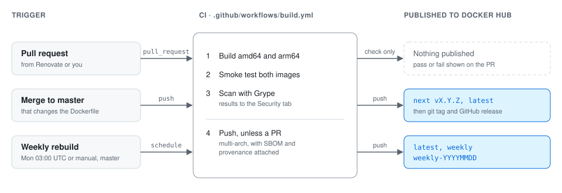

# Repo Maintenance

## How Images Are Built and Published
<picture>
  <source media="(prefers-color-scheme: dark)" srcset="docs/images/release-pipeline-dark.svg">
  
</picture>

All paths run the same workflow, [.github/workflows/build.yml](.github/workflows/build.yml). An image is only pushed after both architectures pass [scripts/smoke-test.sh](scripts/smoke-test.sh). Branch protection on `master` requires the `build` check to pass before any PR can be merged, admins included.

The repo runs itself. You only need to step in when you add a tool or get a failure alert.

- **Renovate** opens PRs on Monday mornings when the base images, yq, nats or GitHub Actions have new versions. They auto-merge once the `build` check passes. A PR that fails stays open and sends an alert.
- **Releases** happen automatically when a merge to master changes the [Dockerfile](Dockerfile). See [Releasing](#releasing).
- **Weekly rebuild** (Mondays 03:00 UTC) rebuilds master to pick up Ubuntu security patches and pushes `latest` and `weekly`. It doesn't create a release.

## Where Versions Live
| What                   | Where                                                            | Updated by               |
| ---------------------- | ---------------------------------------------------------------- | ------------------------ |
| Ubuntu base image      | `FROM ubuntu:26.04@sha256:...` in [Dockerfile](Dockerfile)       | Renovate (digest)        |
| Go used to build tools | `FROM golang:...` in [Dockerfile](Dockerfile)                    | Renovate                 |
| yq, nats               | `ARG YQ_VERSION`, `ARG NATS_VERSION` with `# renovate:` comments | Renovate                 |
| mc                     | `ARG MC_VERSION`                                                 | Fixed; upstream archived |
| apt packages           | Not pinned                                                       | Weekly rebuild           |
| GitHub Actions         | [.github/workflows/build.yml](.github/workflows/build.yml)       | Renovate (digest)        |

To track a new Go tool with Renovate, add an `ARG` with a comment above it in the same format:
```dockerfile
# renovate: datasource=github-releases depName=OWNER/REPO
ARG TOOL_VERSION=v1.2.3
```

## Making a Change
```bash
git switch -c my-change

# edit the Dockerfile, then build and test locally
docker build -t kubernetes-admin-toolkit:testing .
./scripts/smoke-test.sh kubernetes-admin-toolkit:testing

# poke around (optional)
docker run -it --rm kubernetes-admin-toolkit:testing

# open a PR - CI builds and tests amd64 and arm64
git push -u origin my-change
gh pr create --fill

# merge once CI passes
gh pr merge --squash --delete-branch
```

When adding a tool, also add it to the `for cmd in ...` list in [scripts/smoke-test.sh](scripts/smoke-test.sh) and the table in [README.md](README.md#whats-inside).

Local builds are amd64 only unless QEMU is set up. To test arm64 locally:
```bash
docker run --privileged --rm tonistiigi/binfmt --install arm64
docker buildx build --platform linux/arm64 --load -t kubernetes-admin-toolkit:arm64 .
./scripts/smoke-test.sh kubernetes-admin-toolkit:arm64 linux/arm64
```

## Releasing
Releases are automatic. When a push to master changes the Dockerfile, CI builds and tests the image, pushes the next `vX.Y.Z` and `latest`, then creates the git tag and a [GitHub release](https://github.com/adegoodyer/kubernetes-admin-toolkit/releases) with generated notes. Changes to docs, CI or Renovate config don't release.

[scripts/next-version.sh](scripts/next-version.sh) picks the version from the commit messages since the last release:

| Commit message contains                      | Bump  | Example            |
| -------------------------------------------- | ----- | ------------------ |
| `[major]`, `BREAKING CHANGE` or `type!:`     | major | `v1.2.3 -> v2.0.0` |
| `[minor]` or starts with `feat:`             | minor | `v1.2.3 -> v1.3.0` |
| anything else, including Renovate updates    | patch | `v1.2.3 -> v1.2.4` |

So when you add a tool, title the PR `feat: add <tool>`. The squash-merge commit takes the PR title, which makes it a minor release.

```bash
# see what the next release would be
./scripts/next-version.sh

# release now instead of waiting for a merge (also runs the weekly rebuild)
gh workflow run build.yml --ref master
```

Pushing a `vX.Y.Z` tag by hand still builds and pushes that version, but doesn't create a GitHub release. Check the result on [Docker Hub](https://hub.docker.com/r/adegoodyer/kubernetes-admin-toolkit/tags).

## Running the Weekly Build by Hand
```bash
gh workflow run build.yml --ref master
gh run watch
```

## Notifications
Failed runs are reported by GitHub's own email notifications (**Settings → Notifications → Actions** on your GitHub account). A failed Renovate PR also shows on the PR and won't auto-merge.

GitHub turns off scheduled workflows in public repos after 60 days without commits. Merged Renovate PRs count as commits, but if the weekly build stops running, re-enable it under **Actions → Build**.

## One-Time Setup

### Docker Hub
CI logs in with the repo secrets `DOCKERHUB_USERNAME` and `DOCKERHUB_TOKEN`.

1. On Docker Hub, go to **Account settings → Personal access tokens → Generate new token**.
2. Description `github-actions kubernetes-admin-toolkit`, access **Read & Write**, and an expiry date you'll remember to renew.
3. Save it to the repo:
   ```bash
   gh secret set DOCKERHUB_USERNAME --body adegoodyer
   gh secret set DOCKERHUB_TOKEN    # paste the token when prompted
   ```
4. Check it works: `gh workflow run build.yml --ref master`, then look for a green **Login to Docker Hub** step.

Rotate the token by generating a new one, running step 3 again, and revoking the old one on Docker Hub.

### Renovate
Renovate runs from the self-hosted instance in the private `proxmox-three` repo (`platform/renovate/renovatejob-kubernetes-admin-toolkit.yaml`), as the GitHub App `proxmox-three-renovate`, every Monday at 06:00 UK.

1. On GitHub, go to **Settings → Applications → proxmox-three-renovate → Configure**, and add `kubernetes-admin-toolkit` under **Repository access**.
2. Turn on auto-merge for the repo, so GitHub can merge Renovate PRs once `build` passes:
   ```bash
   gh api -X PATCH repos/adegoodyer/kubernetes-admin-toolkit -F allow_auto_merge=true
   ```
3. Merge the RenovateJob in `proxmox-three` so Argo CD deploys it.
4. Start the first run from the operator UI (**run now**) rather than waiting for Monday. Renovate opens PRs labelled `dependencies` and turns on auto-merge for each one. There's no Dependency Dashboard issue (`dependencyDashboard: false`).

Configuration is in [renovate.json](renovate.json). Updates to yq, nats and GitHub Actions wait 3 days after their release (`minimumReleaseAge`) before Renovate opens a PR, in case a release is pulled. Base image updates aren't delayed.
