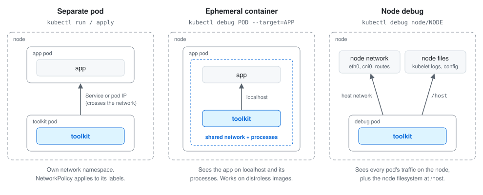

# kubernetes-admin-toolkit

 

A small Ubuntu 26.04 image of network, database and messaging tools for debugging inside Kubernetes clusters and Docker networks.

- `linux/amd64` and `linux/arm64`
- GMT timezone and `en_GB` locale
- AWS RDS `eu-west-2` CA bundle at `/eu-west-2-bundle.pem`
- Rebuilt weekly with current Ubuntu security patches

## Quick Start
```bash
# throwaway shell in the current namespace (pod is deleted on exit)
kubectl run -it --rm toolkit --restart=Never \
  --image=adegoodyer/kubernetes-admin-toolkit:latest

# one-off command
kubectl run -it --rm toolkit --restart=Never \
  --image=adegoodyer/kubernetes-admin-toolkit:latest -- \
  dig +search +short kubernetes.default
```

Then see the [command cheat sheet](docs/commands.md) or the [troubleshooting guide](docs/troubleshooting.md).

## What's Inside
| Area           | Tools                                                                    |
| -------------- | ------------------------------------------------------------------------ |
| DNS            | `dig`, `host`, `nslookup`                                                |
| Connectivity   | `ip`, `ss`, `ping`, `nc` (netcat-traditional), `telnet`, `traceroute`, `mtr`, `nmap` |
| HTTP and TLS   | `curl`, `wget`, `openssl`                                                |
| Packet capture | `tcpdump`                                                                |
| Databases      | `psql`, `pg_isready`, `pg_dump` (PostgreSQL 18 client), `sqlite3`        |
| Object storage | `mc` (MinIO client, final release; upstream is archived)                 |
| Messaging      | `nats`                                                                   |
| Data           | `jq`, `yq`                                                               |
| Files and disk | `rsync`, `unzip`, `duf`                                                  |
| Benchmarking   | `hyperfine`                                                              |

`kubectl` is not included. Run it from your workstation.

## Choosing How to Run It
<picture>
  <source media="(prefers-color-scheme: dark)" srcset="docs/images/run-modes-dark.svg">
  
</picture>

| You want to...                                                         | Use                                         |
| ---------------------------------------------------------------------- | ------------------------------------------- |
| Test DNS, Services or NetworkPolicy the way another pod would see them | [Separate pod](#separate-pod)               |
| Inspect a running pod, including distroless or crash-looping images    | [Ephemeral container](#ephemeral-container) |
| Look at node networking, kubelet logs or all traffic on a node         | [Node debug](#node-debug)                   |
| Debug containers on your own machine                                   | [Docker](#docker)                           |

## Usage

### Separate Pod
```bash
# interactive shell, deleted on exit
kubectl run -it --rm toolkit --restart=Never \
  --image=adegoodyer/kubernetes-admin-toolkit:latest

# long-running pod to exec into repeatedly
kubectl run toolkit --restart=Never \
  --image=adegoodyer/kubernetes-admin-toolkit:latest \
  --command -- sleep infinity
kubectl exec -it toolkit -- bash
kubectl delete pod toolkit

# run with another pod's labels, so the same NetworkPolicies apply
kubectl run -it --rm toolkit --restart=Never \
  --image=adegoodyer/kubernetes-admin-toolkit:latest \
  --labels=app=frontend

# pin to a specific node
kubectl run -it --rm toolkit --restart=Never \
  --image=adegoodyer/kubernetes-admin-toolkit:latest \
  --overrides='{"spec":{"nodeName":"NODE_NAME"}}'
```

#### Least-Privilege Pod
[k8s/toolkit-pod.yaml](k8s/toolkit-pod.yaml) adds resource limits, drops all capabilities except `NET_RAW`, skips the service account token, and deletes itself after one hour. It passes the `baseline` Pod Security Standard.
```bash
kubectl apply -n NAMESPACE -f k8s/toolkit-pod.yaml
kubectl exec -n NAMESPACE -it k8s-toolkit -- bash
kubectl delete -n NAMESPACE pod k8s-toolkit
```
Under these restrictions `tcpdump` cannot switch user, so run it with `-Z root`.

### Ephemeral Container
Adds the toolkit to a running pod without restarting it. It shares the pod's network, so the app is on `localhost`, and with `--target` it can see the app's processes.
```bash
kubectl debug -it POD_NAME \
  --image=adegoodyer/kubernetes-admin-toolkit:latest \
  --target=CONTAINER_NAME \
  --profile=netadmin

# inside: the app's listening ports and processes
nc -zv localhost 8080
ps aux
```
Ephemeral containers can't be removed; they go away when the pod is deleted.

### Node Debug
Runs the toolkit on a node with the host's network, PID and IPC namespaces, and the node's filesystem mounted at `/host`.
```bash
kubectl debug node/NODE_NAME -it \
  --image=adegoodyer/kubernetes-admin-toolkit:latest \
  --profile=sysadmin

# inside: node interfaces, routes, kubelet logs
ip -br addr && ip route
chroot /host journalctl -u kubelet --since "15 min ago"

# afterwards, remove the debug pod
kubectl get pods -o name | grep node-debugger | xargs kubectl delete
```

### Docker
```bash
# disposable shell
docker run -it --rm adegoodyer/kubernetes-admin-toolkit:latest

# one-off command
docker run --rm adegoodyer/kubernetes-admin-toolkit:latest curl -sI https://example.com

# join another container's network namespace (its ports are on localhost)
docker run -it --rm --network container:CONTAINER_NAME \
  adegoodyer/kubernetes-admin-toolkit:latest

# join a compose or user-defined network (service names resolve)
docker run -it --rm --network NETWORK_NAME \
  adegoodyer/kubernetes-admin-toolkit:latest

# host network
docker run -it --rm --network host \
  adegoodyer/kubernetes-admin-toolkit:latest

# persistent container
docker run -itd --name toolkit adegoodyer/kubernetes-admin-toolkit:latest
docker exec -it toolkit bash
docker rm -f toolkit
```

## Image Tags
| Tag                         | Meaning                                                |
| --------------------------- | ------------------------------------------------------ |
| `vX.Y.Z`                    | Released version, built from the git tag               |
| `latest`                    | Most recent release or weekly rebuild                  |
| `weekly`, `weekly-YYYYMMDD` | Weekly rebuild of master with current security patches |

Use `vX.Y.Z` or `weekly-YYYYMMDD` when you need the same image every time.

## Security
Vulnerability scan results are published to the repository's [Security tab](https://github.com/adegoodyer/kubernetes-admin-toolkit/security/code-scanning). Each pushed image carries an SBOM and build provenance attestation.
```bash
# view the SBOM attached to the image
docker buildx imagetools inspect adegoodyer/kubernetes-admin-toolkit:latest --format '{{ json .SBOM }}'

# scan locally
grype adegoodyer/kubernetes-admin-toolkit:latest
```

The image runs as root and includes tools like `nmap` and `tcpdump`, so keep pods short-lived and prefer the [least-privilege manifest](#least-privilege-pod).

## Docs
- [Command cheat sheet](docs/commands.md): DNS, HTTP, TLS, connectivity, capture, Postgres, MinIO, NATS
- [Troubleshooting guide](docs/troubleshooting.md): step-by-step checks for common failures
- [Repo maintenance](README-repo-maintenance.md): how the image is built, tested and released
